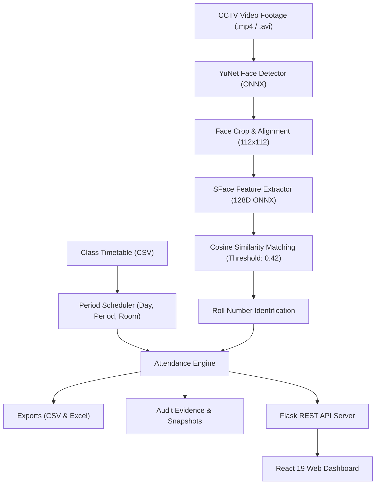

# Sreenidhi University Smart Attendance System 🎓📸

[](https://github.com/ValamallaSiddharth/Class_Attendance_Project/actions)


An automated smart attendance management system using CCTV feeds, deep learning facial detection (**YuNet**) and facial recognition (**SFace**), combined with university class timetable scheduling and a modern interactive web dashboard (**React + Flask**).

---

## 🏗️ System Architecture



---

## 🌟 Key Features

- **Automated Face Recognition**: Real-time face detection with YuNet ONNX and 128D feature extraction via SFace ONNX.
- **Timetable-Aware Processing**: Maps processing to scheduled periods, rooms, and teachers from `timetable/class_timetable.csv`.
- **Modern React Dashboard**: Built with React 19 and Vite; includes real-time attendance rate metrics, period cards, and student tables.
- **Manual Attendance Overrides**: Allows teachers to review detection evidence and manually override statuses with full audit logging.
- **Multi-Format Reports**: Automated generation of CSV and formatted Excel (`.xlsx`) records in `exports/`.
- **Continuous Integration**: GitHub Actions CI pipeline running automated testing and frontend builds on every commit.
- **Docker Support**: Single-command container deployment via Docker and Docker Compose.

---

## 📁 Repository Structure

```text
Class_Attendance_Project/
├── .github/                    # CI/CD workflows and issue templates
│   ├── workflows/ci.yml        # Automated test and build pipeline
│   ├── ISSUE_TEMPLATE/         # Bug report & feature request templates
│   └── pull_request_template.md
├── app.py                      # Main Flask application and API server
├── api_server.py               # Secondary lightweight API server
├── Dockerfile                  # Multi-stage production container image
├── docker-compose.yml          # Container orchestration configuration
├── requirements.txt            # Python dependencies
├── package.json                # Root package configuration (scripts)
├── .env.example                # Environment variables template
├── LICENSE                     # MIT License
├── CONTRIBUTING.md             # Contribution guidelines
├── CODE_OF_CONDUCT.md          # Contributor code of conduct
├── SECURITY.md                 # Security vulnerability reporting policy
│
├── models/                     # Deep learning models & labels
│   ├── face_detection_yunet_2023mar.onnx
│   ├── face_recognition_sface_2021dec.onnx
│   ├── sface_embeddings.pkl
│   ├── trainer.yml
│   └── labels.txt
│
├── my-react-website/           # React 19 + Vite frontend source code
│   ├── src/                    # UI Components and pages
│   ├── public/                 # Static assets
│   └── dist/                   # Production build (served by Flask)
│
├── scripts/                    # Automation and utility scripts
│   ├── crop_dataset_faces.py   # Crop student faces from images
│   ├── create_sface_embeddings.py # Generate SFace embeddings
│   ├── augment_dataset.py      # Face dataset augmentation tool
│   ├── timetable_attendance.py # Core attendance recognition engine
│   ├── mark_attendance.py      # CLI attendance runner
│   ├── run_smoke_test.py       # API smoke test
│   └── verify_all.py           # Comprehensive system test suite
│
├── tests/                      # Automated unit test suite
│   ├── test_api_endpoints.py   # API route tests
│   └── test_timetable_logic.py # Timetable & schedule tests
│
├── templates/                  # Jinja2 HTML templates for reports
├── timetable/                  # Timetable configuration (CSV)
├── cctv_videos/                # CCTV video footage
├── dataset/                    # Raw student image dataset
├── cropped_dataset/            # Cropped student face dataset
├── data/                       # Attendance runs, logs, and manual overrides
├── exports/                    # Generated CSV and Excel attendance reports
└── runtime/                    # Evidence images and checkpoint frames
```

---

## 🚀 Quickstart

### Method 1: Local Installation

#### 1. Python Virtual Environment
```bash
python -m venv .venv

# Windows:
.venv\Scripts\activate

# Linux / macOS:
source .venv/bin/activate

pip install -r requirements.txt
```

#### 2. Frontend Build
```bash
npm run build
```

#### 3. Run Application
```bash
python app.py
```
Visit **`http://127.0.0.1:5000`** in your browser.

---

### Method 2: Docker Deployment

Run the entire stack with Docker Compose:
```bash
docker compose up --build
```
Access the application at `http://localhost:5000`.

---

## 🧪 Testing & Verification

Run the comprehensive 26-point verification suite:
```bash
python scripts/verify_all.py
```

Run unit tests:
```bash
python -m unittest discover -s tests -v
```

Run API smoke tests:
```bash
python scripts/run_smoke_test.py
```

---

## 🤝 Contributing

Contributions are welcome! Please read [CONTRIBUTING.md](CONTRIBUTING.md) and our [CODE_OF_CONDUCT.md](CODE_OF_CONDUCT.md) before submitting a Pull Request.

---

## 📄 License

This project is licensed under the [MIT License](LICENSE) - see the LICENSE file for details.
